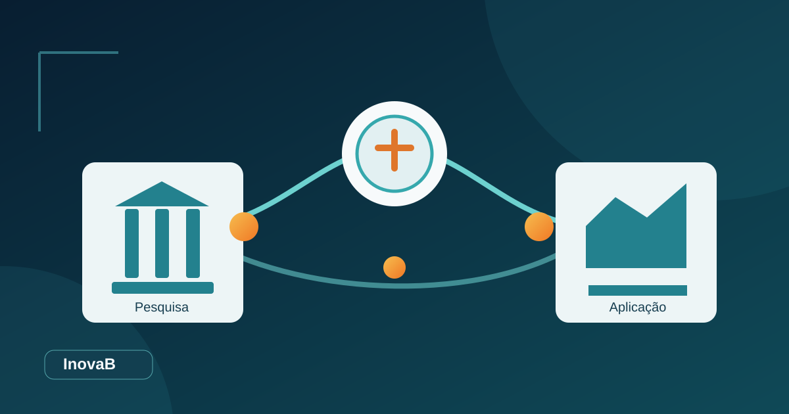

# O papel da inteligência tecnológica na transferência de conhecimento das universidades

A universidade produz conhecimento em diferentes formatos: publicações, processos, métodos, programas de computador, materiais, resultados experimentais e formação especializada. Uma parte desse conhecimento pode atender necessidades de empresas, serviços públicos, organizações sociais e comunidades. Entretanto, a conexão entre uma pesquisa e seus potenciais usuários costuma depender de informação organizada, interpretação técnica e articulação institucional.

É nesse contexto que a **inteligência tecnológica** pode ajudar. Ao reunir evidências sobre pesquisas, áreas de aplicação e oportunidades, ela apoia decisões sobre o que merece aprofundamento, proteção, desenvolvimento ou aproximação com parceiros.

A Organização Mundial da Propriedade Intelectual (OMPI/WIPO) descreve a transferência de conhecimento e tecnologia como um processo colaborativo pelo qual resultados científicos, conhecimentos e direitos de propriedade intelectual podem circular de seus criadores para usuários públicos e privados. Não existe uma única rota: a transferência pode envolver licenciamento, colaboração em pesquisa, consultoria, formação e diferentes modelos de interação.

## O que significa inteligência tecnológica na prática?

Inteligência tecnológica é a organização e a interpretação sistemática de informações relevantes para decisões relacionadas a tecnologias e conhecimento aplicado.

Nas universidades, isso pode envolver perguntas bastante concretas:

- Que linhas de pesquisa desenvolveram soluções com aplicações potenciais?
- Quais trabalhos apresentam resultados experimentais ou protótipos?
- Em que setores essas soluções poderiam ser utilizadas?
- Que informações adicionais precisam ser obtidas dos pesquisadores?
- Há atividades semelhantes já descritas em patentes, artigos ou produtos?
- Quais grupos de pesquisa e organizações deveriam participar da avaliação?

As respostas podem vir de repositórios acadêmicos, bases de patentes, publicações, entrevistas, relatórios tecnológicos, dados institucionais e consultas a especialistas. A escolha da fonte depende da finalidade e das autorizações de acesso.

Essa diversidade exige discernimento. **Reunir muitos documentos não significa compreender suas implicações.** A inteligência surge quando as informações são contextualizadas, validadas e transformadas em prioridades de ação.

## Como a inteligência tecnológica ajuda os NITs?

No Brasil, a Lei de Inovação, Lei nº 10.973/2004, define o Núcleo de Inovação Tecnológica (NIT) como estrutura associada à gestão da política institucional de inovação de uma ou mais ICTs. O alcance e a organização concreta das atribuições dependem da legislação e das regras institucionais.

Um NIT frequentemente precisa equilibrar diferentes atividades: atender pesquisadores, examinar comunicações de invenção, orientar proteção intelectual, acompanhar ativos tecnológicos e negociar possíveis transferências.

Uma rotina de inteligência tecnológica pode contribuir para esse trabalho em quatro momentos.

### 1. Identificar resultados ainda pouco conhecidos

A busca periódica em repositórios e registros institucionais pode revelar trabalhos que não chegaram espontaneamente à equipe responsável pela inovação.

Isso **não substitui** o procedimento formal de comunicação de invenções. Trata-se de uma fonte complementar de indícios, especialmente útil para estruturar entrevistas e descobrir atividades de pesquisa com possíveis aplicações.

### 2. Priorizar o trabalho da equipe

Uma classificação preliminar pode agrupar registros por assunto, tipo de resultado ou potencial contexto de uso. A priorização ajuda a distribuir o esforço de leitura, desde que os critérios sejam conhecidos e revisados.

Por exemplo, uma equipe pode priorizar trabalhos com experimentação aplicada e documentação de protótipo. Outra poderá dedicar atenção a métodos com aplicação em políticas públicas. A decisão é institucional e depende do objetivo da prospecção.

### 3. Preparar diligências tecnológicas

Depois da triagem, a equipe precisa aprofundar informações que raramente estão completas em um resumo acadêmico.

Pode ser necessário verificar o nível de desenvolvimento, a reprodutibilidade, os custos, os requisitos normativos, a titularidade de resultados, as permissões de uso e a existência de divulgações anteriores.

Para invenções potencialmente patenteáveis, o INPI recomenda a pesquisa de anterioridade. Esse exame tem finalidade e critérios diferentes dos utilizados em uma triagem textual inicial.

### 4. Aproximar conhecimento e demanda

A prospecção orientada por problemas externos pode revelar oportunidades de colaboração: uma empresa necessita melhorar a eficiência de determinado processo; uma prefeitura enfrenta um problema de gestão; uma organização de saúde precisa de uma metodologia de análise.

Quando uma pesquisa oferece uma resposta plausível, inicia-se uma investigação sobre adequação, responsabilidades, benefícios, riscos e condições de adoção.

## Do achado acadêmico ao encaminhamento institucional

Considere um exemplo hipotético: um grupo universitário documenta um procedimento para monitorar a qualidade de água em instalações pequenas. A triagem identifica o resultado porque ele descreve um problema, um método e uma validação experimental.

O NIT ou uma equipe designada pode então examinar a documentação, conversar com os autores, buscar informações sobre desenvolvimentos semelhantes, avaliar requisitos regulatórios e decidir se há oportunidade de continuidade com parceiros.

O resultado dessa investigação pode ser uma parceria de pesquisa, um piloto, uma capacitação, uma publicação técnica ou uma estratégia de proteção intelectual. Em certos casos, a recomendação será não avançar.

**A qualidade do processo está em registrar por que a decisão foi tomada**, inclusive quando a oportunidade inicialmente sinalizada se revela inviável.

## O papel dos repositórios acadêmicos

Repositórios institucionais são pontos de acesso importantes para parte da produção universitária. Sua utilização na inteligência tecnológica permite construir uma visão mais abrangente de trabalhos públicos ou autorizados, com links para as fontes de origem.

Mas existem limites. O acervo pode conter registros incompletos, diferentes versões de metadados, restrições documentais e diferenças entre sistemas. Uma busca automatizada precisa registrar sua cobertura e as falhas de extração.

Outro cuidado diz respeito à confidencialidade. Pesquisas ainda não publicadas, documentos sob embargo e informações restritas exigem fluxos próprios. O fato de um sistema localizar um registro público não dispensa a observação das políticas institucionais e dos direitos sobre o conteúdo.

## Como ferramentas computacionais entram nesse processo?

Sistemas de coleta, normalização, deduplicação e classificação ajudam a organizar grandes conjuntos de registros. Ferramentas como o InovaB podem apoiar uma etapa de **triagem exploratória**, indicando trabalhos candidatos à revisão especializada.

No ambiente operacional documentado da UEPB, o InovaB utiliza regras textuais e heurísticas para classificar registros acadêmicos. O sistema mantém referências aos trabalhos, permitindo ao usuário consultar suas fontes.

Essa classificação não corresponde a uma avaliação completa de mercado, a um relatório de busca patentária, a um diagnóstico de maturidade tecnológica ou a uma recomendação automática de licenciamento. Essas decisões continuam sujeitas à diligência humana.

Uma arquitetura institucional responsável pode combinar o processamento automatizado com etapas humanas bem definidas: leitura dos candidatos, registro da avaliação, comunicação com pesquisadores, análise de propriedade intelectual e eventual articulação com parceiros.

Para entender uma aplicação concreta desse fluxo, consulte [Como funciona o InovaB](/como-funciona). Para avaliar uma instalação institucional, acesse [InovaB para instituições](/para-instituicoes).

## Como avaliar o retorno operacional da inteligência tecnológica?

É recomendável medir a utilidade do processo, evitando usar apenas o volume de documentos processados. Indicadores possíveis incluem:

**Cobertura:** parcela dos registros elegíveis efetivamente examinados.

**Pertinência:** proporção de candidatos julgados úteis por revisores, em uma amostra conhecida.

**Tempo de triagem:** esforço necessário para avaliar determinado conjunto de trabalhos.

**Rastreabilidade:** proporção de sinais ligados corretamente a documentos de origem.

**Encaminhamentos qualificados:** número de pesquisas efetivamente direcionadas para entrevistas, análise especializada ou desenvolvimento adicional.

**Aprendizado:** tipos recorrentes de falsos positivos e problemas de metadados identificados ao longo das revisões.

Esses indicadores não devem ser confundidos automaticamente com patentes depositadas, contratos celebrados ou receitas geradas. A ligação entre uma triagem e um resultado econômico exige dados e metodologia próprios.

## Perguntas frequentes

### Inteligência tecnológica é a mesma coisa que pesquisa de patentes?

Não. A pesquisa de patentes é uma fonte e uma atividade especializada que pode integrar processos de inteligência tecnológica. A inteligência pode considerar outras evidências e problemas decisórios.

### Um NIT precisa ter inteligência artificial para fazer inteligência tecnológica?

Não. Organização de informações, análise de especialistas, regras de classificação e processos bem definidos já permitem atividades de inteligência tecnológica. Técnicas adicionais de IA devem ser adotadas quando demonstrarem utilidade e confiabilidade.

### Toda pesquisa com aplicação potencial deve ser patenteada?

Não. A rota depende da natureza do resultado, dos requisitos legais, dos objetivos dos pesquisadores e das políticas institucionais. Algumas contribuições podem ser disseminadas por outras modalidades.

### Como começar com recursos limitados?

Uma estratégia viável é escolher um repositório autorizado, definir critérios de triagem, revisar uma amostra de resultados e medir a pertinência dos candidatos antes de ampliar a operação.

## Referências e leituras recomendadas

1. OMPI/WIPO. [Knowledge and Technology Transfer](https://www.wipo.int/en/web/technology-transfer).
2. OMPI/WIPO. [IP Policies for Universities and Research Institutions](https://www.wipo.int/en/web/technology-transfer/ip-policies).
3. Câmara dos Deputados. [Lei nº 10.973/2004, Lei de Inovação, texto atualizado](https://www2.camara.leg.br/legin/fed/lei/2004/lei-10973-2-dezembro-2004-534975-normaatualizada-pl.html).
4. INPI. [Acesso às bases de pesquisa de anterioridade](https://www.gov.br/inpi/pt-br/servicos/patentes/busca-terceirizada/acessos-as-bases-de-pesquisas).
5. UNESCO. [Recomendação sobre Ciência Aberta](https://www.unesco.org/en/legal-affairs/recommendation-open-science).

> **Nota editorial:** documento pronto para revisão; confirmar autoria, datas, referências internas e nomes institucionais antes da publicação.
